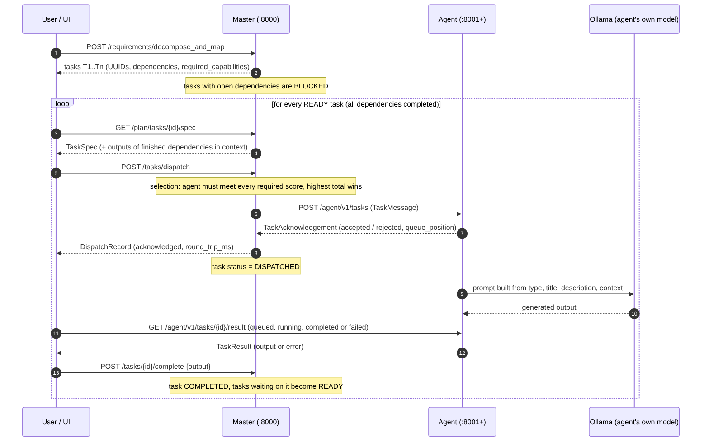

# Master ↔ Agent Message Flow (Sprint 3)

Owner: Nehir Tunç




The flow has three message types between master and agent:
**send task → acknowledgement → result**. Dependencies decide *when* a task may be sent.

## 1. Send task (master → agent)

`POST /agent/v1/tasks` with a `TaskMessage` (see [task-dispatch-contract.md](task-dispatch-contract.md)).
Before it is sent, the master checks:

1. **Dependencies** – every task listed in `depends_on` must be `completed`. Otherwise the
   master answers `400` and nothing is sent.
2. **Selection** – the agent must meet *all three* `required_capabilities` (coding, reasoning,
   context); among those the highest total score wins (`master/selection.py`). No match → `404`.

`context.dependency_outputs` carries the outputs of the finished prerequisite tasks
(`{"T1": "<text>"}`), so the agent can build on earlier work. The agent puts `context` into its prompt.

## 2. Acknowledgement (agent → master)

Returned immediately (target ≤ 200 ms), **before** the model runs. It only says the task was received:

| Answer | Meaning | Master result |
|---|---|---|
| `accepted` + `queue_position` | In the agent's queue | `DispatchRecord.status = acknowledged`, task becomes `dispatched` |
| `rejected` + `reason` | Wrong agent, unsupported type or queue full | `status = rejected` |
| no answer / error | Agent off, slow or broken | `503` / `504` / `502`, record `failed` (reassignment is Sprint 4) |

Sending the same `task_id` again is safe: the agent returns the original ack with `duplicate: true`.

## 3. Result (agent → master side)

The agent runs the task on its own Ollama model in the background and keeps the state:

`queued` → `running` → `completed` (with `output`) **or** `failed` (with `error`)

Read with `GET /agent/v1/tasks/{task_id}/result`. The master is told about the outcome with:

- `POST /api/v1/tasks/{task_id}/complete` with `{"output": "..."}` → task `completed`,
  tasks that were waiting on it become **ready**.
- `POST /api/v1/tasks/{task_id}/fail` → task `failed`; its dependents **stay blocked**.

> Status today: reading the result and calling `complete`/`fail` is done by the caller
> (UI, script or Swagger). Automatic result collection by the master (polling the agent and
> storing a `TaskResult`) is the master-agent owner's Sprint 3 work; the endpoints above stay the same
> when it is automated.

## Task lifecycle in the master

```
pending ──(has open dependencies)──> blocked ──(all dependencies completed)──> pending (ready)
pending/ready ──(agent acknowledged)──> dispatched ──> completed | failed
```

A `failed` task never unblocks its dependents. A dependency cycle (`T1 → T2 → T1`) is rejected
when the plan is created (`422`, message shows the cycle).

## Dependency management

- The decomposition uses text labels (`T1`, `T2`, …). `POST /api/v1/requirements/decompose_and_map`
  maps each label to a UUID and each `dependencies: ["T1"]` to `dependency_uuids`.
- `GET /api/v1/plan/ready` lists tasks that can be sent now.
- `GET /api/v1/plan/tasks/{task_id}/spec` returns the ready-to-send `TaskSpec` (UUID `task_id`,
  `depends_on`, `required_capabilities`, `context.dependency_outputs`).
- A dependency label that does not exist in the plan is ignored (the model may invent labels).
- Several plans can live in one master process; restart the master (or start with a clean demo) to avoid mixing them.
