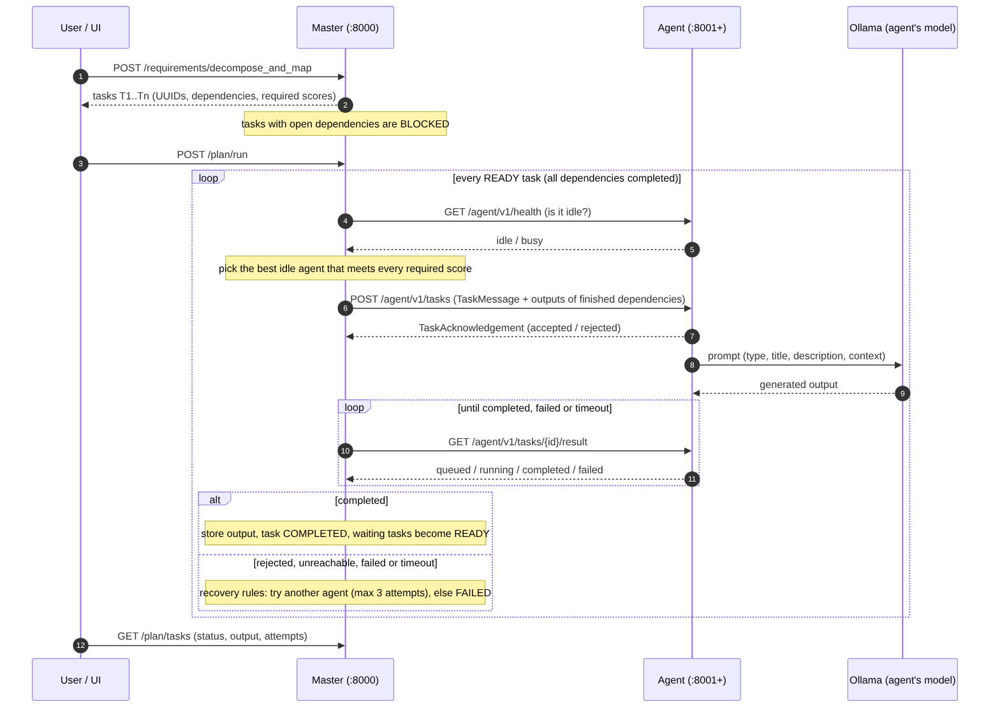

# Master ↔ Agent Message Flow

Owner: Nehir Tunç



Three messages go between master and agent: **send task → acknowledgement → result**. The master decides
*when* a task may be sent (dependencies) and *what to do when something fails* ([error-recovery.md](../error-recovery.md)).

## 1. Plan

`POST /api/v1/requirements/decompose_and_map` splits the requirement into tasks (`T1`, `T2`, …), maps each
label to a UUID and each `dependencies: ["T1"]` to `dependency_uuids`. Tasks with open dependencies are
`blocked`. A dependency cycle (`T1 → T2 → T1`) is rejected with `422`.

## 2. Send task (master → agent)

For every **ready** task (all dependencies completed) the master:

1. asks the suitable agents `GET /agent/v1/health` and keeps the ones that are `idle`;
2. picks the best one: it must meet **all three** required scores (coding, reasoning, context), highest total wins
   (`master/selection.py`);
3. sends `POST /agent/v1/tasks` with a `TaskMessage`. `context.dependency_outputs` holds the outputs of the
   finished prerequisite tasks (`{"T1": "<text>"}`), so the agent builds on earlier work.

## 3. Acknowledgement (agent → master)

Returned immediately, **before** the model runs. It only says the task was received.

| Answer | Meaning |
|---|---|
| `accepted` + `queue_position` | In the agent's queue |
| `rejected` + `reason` | Wrong agent, unsupported type or queue full → recovery rule 4 |
| no answer / error | Agent off, slow or broken → recovery rule 5 |

Sending the same `task_id` again returns the first ack with `duplicate: true`, unless that task failed or was
rejected before; then the agent runs it again.

## 4. Result

The agent runs the task on its own Ollama model in the background. The master asks
`GET /agent/v1/tasks/{task_id}/result` until the state is final:

`queued` → `running` → `completed` (with `output`) **or** `failed` (with `error`)

- `completed`: if a dedicated Review Agent (`supported_types: ["review"]`) is registered, the master dispatches a `review` task with `context.artifact`. If `decision == "approved"` (or no Review Agent is registered), the master stores the output and marks the task `completed`. If `decision == "rejected"` (or the review output is empty/malformed), the attempt is recorded as `review_rejected` and enters recovery rule 13 (retry on another agent).
- `failed`, no result in time, or agent unreachable: recovery rules 6 to 8 (try another agent, max 3 attempts).

## 5. Running it

`POST /api/v1/plan/run` does steps 2 to 4 for the whole plan. Independent tasks run at the same time.
`?wait=true` returns when the plan is done; without it the call returns at once and the progress can be read from
`GET /api/v1/plan/tasks` and `GET /api/v1/plan/run`.

The same steps can be done by hand, which is useful for debugging: `GET /plan/tasks/{id}/spec` →
`POST /tasks/dispatch` → `GET <agent>/agent/v1/tasks/{id}/result` → `POST /tasks/{id}/complete` (or `/fail`).

## Task lifecycle in the master

```
pending ──(has open dependencies)──> blocked ──(all dependencies completed)──> pending (ready)
pending ──(agent acknowledged)──> dispatched ──> completed
                                       │
                                       ├──(attempt failed, attempts left)──> pending (another agent)
                                       └──(attempts used up / no agent left)──> failed
```

A `failed` task never unblocks its dependents. Details and settings: [error-recovery.md](../error-recovery.md).
