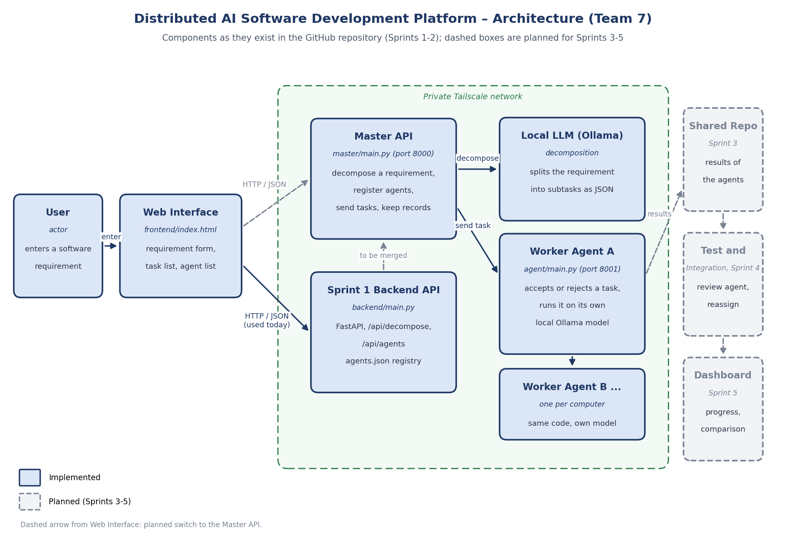

# Architecture Document

**Project:** Distributed AI Software Development Platform (CM6453 Software Processes, Team 7)
**Version:** 1.1 (end of Sprint 1, updated with Sprint 2 code) · **Author:** Nehir Tunç

## 1. Overview

A user enters a software requirement. A **master agent** splits it into subtasks with a local LLM, and sends tasks to **worker agents**. Each worker agent runs on its own computer and uses its own local model through Ollama (for example `llama3` or `qwen2.5-coder:1.5b`). No cloud API key is needed. The master and the agents talk over HTTP and JSON.

## 2. Components

| Component | Location in the repository | What it does |
|---|---|---|
| Web interface | `frontend/index.html` | Requirement form, task list, agent list and agent registration form. |
| Sprint 1 backend API | `backend/main.py`, `backend/master_agent.py`, `backend/agents.json` | FastAPI app used by the web interface today: `/api/decompose` splits a requirement, `/api/agents` adds, lists and removes agents (stored in `agents.json`). |
| Master API | `master/main.py`, `master/decompose.py` | FastAPI app on port 8000: decomposes a requirement (`/api/v1/requirements/decompose`), registers agents, sends a task to a chosen agent and keeps the dispatch records (`/api/v1/agents`, `/api/v1/agents/{id}/tasks`, `/api/v1/tasks`). |
| Worker agent | `agent/main.py` | One per computer (port 8001 and up). Receives a task, accepts or rejects it (wrong agent, unsupported type, full queue), runs it on its own Ollama model and reports health and result. |
| Shared code | `shared/schemas.py`, `shared/network.py` | Message formats (the API contract) and network address settings. |
| Tests and CI | `tests/`, `.github/workflows/ci.yml` | pytest suite that runs on every push and pull request. |

If the local model is not available, decomposition falls back to a fixed five-task breakdown, so the endpoint still works offline and in tests.

## 3. Main flow

1. The user types a requirement in the web interface.
2. The interface sends it to the backend (`/api/decompose`).
3. A local LLM splits it into subtasks (id, title, category, description, dependencies).
4. The interface shows the task list and the registered agents.
5. The master registers a worker agent and sends it a task (`POST /api/v1/agents/{id}/tasks`).
6. The agent answers at once with an acknowledgement (accepted or rejected, queue position) and runs the task in the background; its result is read with `GET /agent/v1/tasks/{task_id}/result`.
7. *(Sprint 3 to 5)* Results are collected in a shared repository, tested, integrated and shown on a dashboard.

## 4. Data

**Subtask:** `task_id`, `title`, `category` (frontend, backend, database, testing, documentation, integration, requirements), `description`, `dependencies`.

**Agent:** `agent_id`, `name` or `base_url`, `model`, capability scores `coding`, `reasoning`, `context` (0 to 100).

**Task message and acknowledgement:** defined in `shared/schemas.py` and described in `docs/api/task-dispatch-contract.md`.

## 5. Design decisions

| Decision | Reason |
|---|---|
| Local models with Ollama | Free, no API key, works on every member's computer. |
| FastAPI | Small, fast to build, and gives a test page (Swagger, `/docs`) for the demo. |
| One agent service per computer | Matches the course idea: each computer has its own LLM and strengths. |
| Fallback decomposition | The master keeps working when the model is down. |
| Pydantic schemas shared by master and agents | The message format is the same in code and in the documentation. |
